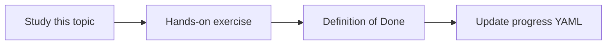

# Contradiction detection

Topic ID: `P7-T09` · Phase: `P7` · Track: `advanced` · Default owner: `developer-a`

## What is it?

Contradictions are overlapping claims with incompatible values, versions, or statuses.

## Why do we need it?

Averaging 15 and 30 minutes into 22.5 is unacceptable.

## How does it work?

Detect numeric and boolean conflicts on the same topic key. Present both with dates and status.

## Example in our project

Design v2 TTL=30 vs ADR 0014 TTL=15 → report conflict, prefer accepted status.

The example uses the synthetic **Atlas Inventory Platform** only. Do not substitute real client systems.

## What must we learn?

- Topic keys
- No averaging
- Status-aware resolve

## Hands-on exercise

Add a golden question whose correct behavior is to report a conflict.

**Deliverable:** Contradiction example in golden set

## Definition of Done

Done is not “the Markdown file exists.” Done means you can explain the topic, you know why it matters for the agent, the exercise (or equivalent) is complete, and all of the following are true:

- Golden exists
- Agent policy written
- No silent resolve

## Resources

Official documentation only. Expand this list as you study; do not add unverified links.

- [Vertex AI generative AI](https://cloud.google.com/vertex-ai/generative-ai/docs)

## Key Takeaways

- Show both sides
- Status can resolve
- Never average facts

## Related Topics

- [P7-T10](../P7/P7-T10-temporal-knowledge-and-superseded-decisions.md)
- [P6-T01](../P6/P6-T01-groundedness.md)
