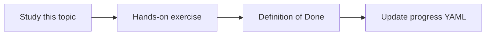

# Temporal knowledge and superseded decisions

Topic ID: `P7-T10` · Phase: `P7` · Track: `advanced` · Default owner: `developer-a`

## What is it?

Temporal knowledge uses effective dates. Superseded items remain searchable with a warning.

## Why do we need it?

Users ask “what was the approved architecture last quarter?”

## How does it work?

Store effective_from/to. Default to as-of now. Allow as-of parameter in tools later.

## Example in our project

As of 2026-03-01, TTL=30m (v2). As of now, TTL=15m (ADR 0014).

The example uses the synthetic **Atlas Inventory Platform** only. Do not substitute real client systems.

## What must we learn?

- effective_from/to
- as-of queries
- Warnings on superseded

## Hands-on exercise

Demonstrate two as-of answers on the TTL topic.

**Deliverable:** As-of query example

## Definition of Done

Done is not “the Markdown file exists.” Done means you can explain the topic, you know why it matters for the agent, the exercise (or equivalent) is complete, and all of the following are true:

- Fields exist in design
- As-of demo
- Superseded warning specified

## Resources

Official documentation only. Expand this list as you study; do not add unverified links.

- [Vertex AI generative AI](https://cloud.google.com/vertex-ai/generative-ai/docs)

## Key Takeaways

- Time is a filter
- Keep superseded
- Warn loudly

## Related Topics

- [P2-T15](../P2/P2-T15-knowledge-freshness.md)
- [P7-T04](../P7/P7-T04-cross-meeting-comparison.md)
