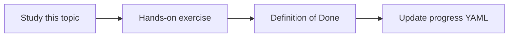

# Containerization

Topic ID: `P8-T01` · Phase: `P8` · Track: `mvp` · Default owner: `developer-b`

## What is it?

A container image pins runtime, dependencies, and non-secret config. It must not contain keys or indexes of private data in this repo.

## Why do we need it?

Cloud Run needs a container. Bloated images slow deploys.

## How does it work?

Multi-stage build, non-root user, pinned base image tags. Indexes loaded at runtime from storage.

## Example in our project

gcr.io/example/atlas-agent:sha-abc serves /ask with GEMINI_MODEL from env.

The example uses the synthetic **Atlas Inventory Platform** only. Do not substitute real client systems.

## What must we learn?

- Non-root
- Pinned tags
- No secrets in layers

## Hands-on exercise

Write a Dockerfile for the skeleton that builds locally.

**Deliverable:** Dockerfile and .dockerignore

## Definition of Done

Done is not “the Markdown file exists.” Done means you can explain the topic, you know why it matters for the agent, the exercise (or equivalent) is complete, and all of the following are true:

- Dockerfile exists
- dockerignore exists
- No secrets copied

## Resources

Official documentation only. Expand this list as you study; do not add unverified links.

- [Cloud Run docs](https://cloud.google.com/run/docs)

## Key Takeaways

- Pin bases
- Run non-root
- Load data at runtime

## Related Topics

- [P3-T08](../P3/P3-T08-cloud-run.md)
- [P8-T02](../P8/P8-T02-ci-cd.md)
