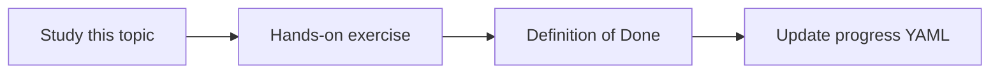

# CI/CD

Topic ID: `P8-T02` · Phase: `P8` · Track: `mvp` · Default owner: `developer-b`

## What is it?

CI runs on pull requests. CD deploys from main only with explicit protection. Dashboard can deploy to GitHub Pages.

## Why do we need it?

Unsigned “deploy from laptop” is not an MVP story.

## How does it work?

Jobs: dashboard, python, yaml validate, pages. Cloud Run deploy is manual or later OIDC.

## Example in our project

A PR that breaks topics.yaml schema fails CI before review.

The example uses the synthetic **Atlas Inventory Platform** only. Do not substitute real client systems.

## What must we learn?

- PR checks
- Pages deploy
- OIDC later

## Hands-on exercise

Confirm workflows exist and fail on a deliberate schema error in a branch (or reason about it).

**Deliverable:** GitHub Actions workflows

## Definition of Done

Done is not “the Markdown file exists.” Done means you can explain the topic, you know why it matters for the agent, the exercise (or equivalent) is complete, and all of the following are true:

- Workflows in repo
- PR checks documented
- No long-lived cloud keys in GitHub if avoidable

## Resources

Official documentation only. Expand this list as you study; do not add unverified links.

- [GitHub Actions](https://docs.github.com/en/actions)

## Key Takeaways

- CI on every PR
- Pages is optional CD
- Prefer OIDC later

## Related Topics

- [P6-T06](../P6/P6-T06-regression-testing.md)
- [P8-T10](../P8/P8-T10-deployment-and-rollback.md)
