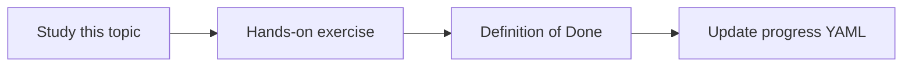

# Infrastructure configuration

Topic ID: `P8-T03` · Phase: `P8` · Track: `mvp` · Default owner: `developer-b`

## What is it?

Document Cloud Run, buckets, and IAM as config you could later apply with Terraform or similar. Do not require Terraform in week 1.

## Why do we need it?

Undocumented click-ops cannot be rolled back.

## How does it work?

Check in example YAML or Markdown with resource names as placeholders.

## Example in our project

cloud-run-service.yaml uses SERVICE_NAME and PROJECT_ID placeholders.

The example uses the synthetic **Atlas Inventory Platform** only. Do not substitute real client systems.

## What must we learn?

- Placeholders
- No real secrets
- Later Terraform optional

## Hands-on exercise

Add an example Cloud Run service YAML with placeholders.

**Deliverable:** Infra notes / example config files

## Definition of Done

Done is not “the Markdown file exists.” Done means you can explain the topic, you know why it matters for the agent, the exercise (or equivalent) is complete, and all of the following are true:

- Example exists
- Placeholders only
- Matches architecture

## Resources

Official documentation only. Expand this list as you study; do not add unverified links.

- [Cloud Run docs](https://cloud.google.com/run/docs)
- [Cloud Storage](https://cloud.google.com/storage/docs)

## Key Takeaways

- Config in git
- No click-ops as source of truth
- Terraform can wait

## Related Topics

- [P8-T04](../P8/P8-T04-environment-separation.md)
- [P3-T09](../P3/P3-T09-iam-and-service-accounts.md)
