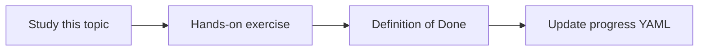

# Environment separation

Topic ID: `P8-T04` · Phase: `P8` · Track: `mvp` · Default owner: `developer-b`

## What is it?

Environments isolate data, secrets, IAM, and model quotas. Synthetic local data never needs production credentials.

## Why do we need it?

A shared “dev” bucket of real documents is a production leak.

## How does it work?

Matrix of env vs project, secrets, index, and who can invoke.

## Example in our project

local=fixtures; staging=synthetic or sanitized; production=authorized real sources (future, not in this repo).

The example uses the synthetic **Atlas Inventory Platform** only. Do not substitute real client systems.

## What must we learn?

- Data isolation
- Secret isolation
- Who can invoke

## Hands-on exercise

Fill the environment matrix.

**Deliverable:** Environment matrix

## Definition of Done

Done is not “the Markdown file exists.” Done means you can explain the topic, you know why it matters for the agent, the exercise (or equivalent) is complete, and all of the following are true:

- Matrix exists
- Local uses fixtures
- Prod data not in git

## Resources

Official documentation only. Expand this list as you study; do not add unverified links.

- [Cloud IAM](https://cloud.google.com/iam/docs)

## Key Takeaways

- Three environments
- No prod data locally
- Separate secrets

## Related Topics

- [P3-T12](../P3/P3-T12-local-versus-cloud-development.md)
- [P6-T08](../P6/P6-T08-least-privilege.md)
