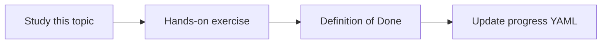

# Monitoring

Topic ID: `P8-T05` · Phase: `P8` · Track: `mvp` · Default owner: `developer-b`

## What is it?

Monitoring is more than logs: SLIs for availability, latency, empty-retrieval rate, and deny rate.

## Why do we need it?

Empty retrieval can look like a “healthy” 200 with useless answers.

## How does it work?

List SLIs, where they are emitted, and a weekly review. Implement Cloud Monitoring later when deployed.

## Example in our project

SLI: ratio of answers with ≥1 citation. Alert if it drops.

The example uses the synthetic **Atlas Inventory Platform** only. Do not substitute real client systems.

## What must we learn?

- SLIs
- Empty retrieval
- Weekly review

## Hands-on exercise

Write SLIs and one alert idea per SLI.

**Deliverable:** Monitoring checklist

## Definition of Done

Done is not “the Markdown file exists.” Done means you can explain the topic, you know why it matters for the agent, the exercise (or equivalent) is complete, and all of the following are true:

- SLI list exists
- Citation rate included
- No fake dashboards required yet

## Resources

Official documentation only. Expand this list as you study; do not add unverified links.

- [Cloud Logging](https://cloud.google.com/logging/docs)

## Key Takeaways

- Monitor answer quality, not only uptime
- Empty retrieval is a symptom
- Review weekly

## Related Topics

- [P8-T09](../P8/P8-T09-connector-health-monitoring.md)
- [P6-T11](../P6/P6-T11-audit-logging.md)
