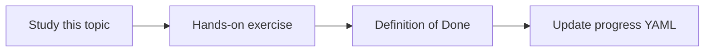

# Cost controls

Topic ID: `P8-T06` · Phase: `P8` · Track: `mvp` · Default owner: `developer-b`

## What is it?

Controls include max tokens, max k, caching, scale-to-zero, and budget alerts in GCP when a project exists.

## Why do we need it?

A runaway reindex can embed the same drive nightly.

## How does it work?

Document caps in config. Add a budget-alert reminder for the first real GCP project.

## Example in our project

Max k=8, max hops=3, Cloud Run max instances=2 in staging.

The example uses the synthetic **Atlas Inventory Platform** only. Do not substitute real client systems.

## What must we learn?

- Token caps
- Max instances
- Budget alerts

## Hands-on exercise

Put numeric caps in a config file and mention GCP budgets in the runbook.

**Deliverable:** Cost control checklist

## Definition of Done

Done is not “the Markdown file exists.” Done means you can explain the topic, you know why it matters for the agent, the exercise (or equivalent) is complete, and all of the following are true:

- Caps in config
- Budget reminder written
- Reindex frequency limited

## Resources

Official documentation only. Expand this list as you study; do not add unverified links.

- [Cloud Run docs](https://cloud.google.com/run/docs)
- [Vertex AI generative AI](https://cloud.google.com/vertex-ai/generative-ai/docs)

## Key Takeaways

- Caps in config, not hope
- Budgets on real projects
- Reindex is a cost center

## Related Topics

- [P4-T20](../P4/P4-T20-indexing-and-reindexing.md)
- [P8-T07](../P8/P8-T07-operational-runbooks.md)
