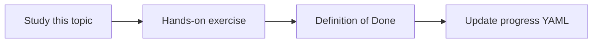

# Operational runbooks

Topic ID: `P8-T07` · Phase: `P8` · Track: `mvp` · Default owner: `developer-b`

## What is it?

Runbooks cover Gemini outage, bad index swap, leaked secret, and connector auth expiry.

## Why do we need it?

Two developers will forget the exact steps under pressure.

## How does it work?

Keep each runbook to a page: symptoms, checks, actions, rollback.

## Example in our project

Bad answers after deploy → check index pointer, last-good snapshot, citation SLI.

The example uses the synthetic **Atlas Inventory Platform** only. Do not substitute real client systems.

## What must we learn?

- Symptoms
- Actions
- Rollback

## Hands-on exercise

Write four runbook stubs in docs.

**Deliverable:** Runbook stubs

## Definition of Done

Done is not “the Markdown file exists.” Done means you can explain the topic, you know why it matters for the agent, the exercise (or equivalent) is complete, and all of the following are true:

- Four stubs exist
- Rollback mentioned
- Secret leak included

## Resources

Official documentation only. Expand this list as you study; do not add unverified links.

- [Cloud Logging](https://cloud.google.com/logging/docs)
- [Secret Manager](https://cloud.google.com/secret-manager/docs)

## Key Takeaways

- Short runbooks
- Include rollback
- Practice once

## Related Topics

- [P8-T10](../P8/P8-T10-deployment-and-rollback.md)
- [P6-T10](../P6/P6-T10-secrets-and-pii-protection.md)
