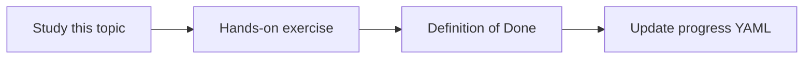

# Performance testing

Topic ID: `P8-T08` · Phase: `P8` · Track: `advanced` · Default owner: `developer-b`

## What is it?

Performance tests use a mix of short identifier queries and multi-hop questions. They are not a million-QPS goal.

## Why do we need it?

The first users will feel p95, not average.

## How does it work?

Define 20-question mix, concurrency 2–5, record p95. Run locally with mocks, later on staging.

## Example in our project

Mix: 50% lookup_symbol, 30% doc RAG, 20% cross-source.

The example uses the synthetic **Atlas Inventory Platform** only. Do not substitute real client systems.

## What must we learn?

- Mix
- p95
- Modest concurrency

## Hands-on exercise

Write the mix and a command placeholder for the later harness.

**Deliverable:** Perf scenario list

## Definition of Done

Done is not “the Markdown file exists.” Done means you can explain the topic, you know why it matters for the agent, the exercise (or equivalent) is complete, and all of the following are true:

- Mix documented
- p95 target labeled
- No fake load-test numbers

## Resources

Official documentation only. Expand this list as you study; do not add unverified links.

- [Cloud Run docs](https://cloud.google.com/run/docs)

## Key Takeaways

- Test the real mix
- p95 over average
- Don’t overclaim capacity

## Related Topics

- [P6-T14](../P6/P6-T14-cost-and-latency-measurement.md)
- [P8-T11](../P8/P8-T11-user-acceptance-testing.md)
