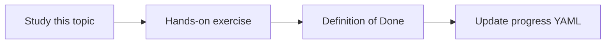

# Deployment and rollback

Topic ID: `P8-T10` · Phase: `P8` · Track: `mvp` · Default owner: `developer-b`

## What is it?

Deploy a tagged image. Roll back by retagging or pointing Cloud Run to the previous revision. Index pointer rolls back separately.

## Why do we need it?

A good binary with a bad index still needs rollback.

## How does it work?

Document two rollbacks: service revision and index snapshot pointer.

## Example in our project

Cloud Run revision 12 bad → traffic to 11. Index 2026-04-02 bad → pointer to 2026-04-01.

The example uses the synthetic **Atlas Inventory Platform** only. Do not substitute real client systems.

## What must we learn?

- Immutable tags
- Two rollback planes
- Health before traffic

## Hands-on exercise

Write the procedure including who may deploy.

**Deliverable:** Deploy/rollback procedure

## Definition of Done

Done is not “the Markdown file exists.” Done means you can explain the topic, you know why it matters for the agent, the exercise (or equivalent) is complete, and all of the following are true:

- Procedure exists
- Index and service separate
- Who-deploys defined

## Resources

Official documentation only. Expand this list as you study; do not add unverified links.

- [Cloud Run docs](https://cloud.google.com/run/docs)

## Key Takeaways

- Two planes to roll back
- Immutable artifacts
- Health checks first

## Related Topics

- [P4-T20](../P4/P4-T20-indexing-and-reindexing.md)
- [P8-T07](../P8/P8-T07-operational-runbooks.md)
