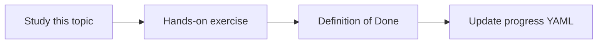

# User acceptance testing

Topic ID: `P8-T11` · Phase: `P8` · Track: `mvp` · Default owner: `developer-a`

## What is it?

UAT is a scripted session on staging or local with the product questions, plus “I don’t know” cases.

## Why do we need it?

Eval scores can pass while UX still confuses engineers.

## How does it work?

Run the checklist, file issues, and record go/no-go.

## Example in our project

UAT includes: rule location, data movement, latest architecture, unresolved questions, deny case.

The example uses the synthetic **Atlas Inventory Platform** only. Do not substitute real client systems.

## What must we learn?

- Scripted questions
- Deny case
- Go/no-go

## Hands-on exercise

Draft the UAT script from golden questions.

**Deliverable:** UAT checklist

## Definition of Done

Done is not “the Markdown file exists.” Done means you can explain the topic, you know why it matters for the agent, the exercise (or equivalent) is complete, and all of the following are true:

- Script exists
- Includes deny and unknown
- Sign-off field included

## Resources

Official documentation only. Expand this list as you study; do not add unverified links.

- [Vertex AI generative AI](https://cloud.google.com/vertex-ai/generative-ai/docs)

## Key Takeaways

- Use real question phrasing
- Include failures
- Sign off explicitly

## Related Topics

- [P6-T05](../P6/P6-T05-golden-questions.md)
- [P8-T12](../P8/P8-T12-production-readiness-checklist.md)
