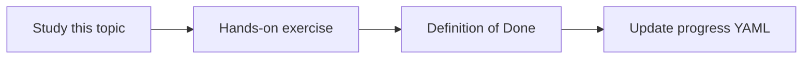

# Production readiness checklist

Topic ID: `P8-T12` · Phase: `P8` · Track: `mvp` · Default owner: `developer-b`

## What is it?

Readiness covers security, eval, ops, cost, legal/privacy review flags, and known limitations.

## Why do we need it?

Without a gate, “we’ll harden later” becomes production.

## How does it work?

A single Markdown checklist with owners and pass/fail. No green without ACL tests.

## Example in our project

Checklist item: permission-aware retrieval tests passing on synthetic ACLs.

The example uses the synthetic **Atlas Inventory Platform** only. Do not substitute real client systems.

## What must we learn?

- Gate items
- Owners
- Known limitations

## Hands-on exercise

Fill the checklist with owners; leave items unchecked until true.

**Deliverable:** Readiness checklist in docs

## Definition of Done

Done is not “the Markdown file exists.” Done means you can explain the topic, you know why it matters for the agent, the exercise (or equivalent) is complete, and all of the following are true:

- Checklist exists
- ACL tests are a hard gate
- Limitations listed

## Resources

Official documentation only. Expand this list as you study; do not add unverified links.

- [Cloud IAM](https://cloud.google.com/iam/docs)
- [Cloud Run docs](https://cloud.google.com/run/docs)

## Key Takeaways

- A checklist is the gate
- ACL is non-negotiable
- List limitations honestly

## Related Topics

- [P6-T07](../P6/P6-T07-permission-aware-retrieval.md)
- [P0-T02](../P0/P0-T02-scope-and-non-goals.md)
